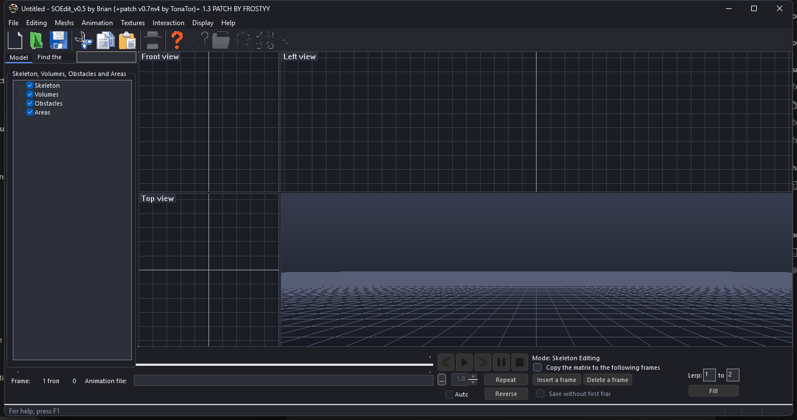

# SOEdit – Patch by Frostyy

Model, animation and volume editor for *Soldiers: Heroes of World War II* / *Call to Arms* style assets.
This branch gives the classic MFC editor a complete modern make-over and fixes several long-standing bugs.



## What's new

**Look & feel**
- Full dark theme: dark title bar, dark menu bar and popup menus, dark dialogs, tree views, tab strip,
  status bar and docked panels (Windows 10 1809+/Windows 11; degrades gracefully elsewhere).
- Custom-drawn modern check boxes, radio buttons, group boxes and flat tabs with an accent underline.
- Toolbar icons re-rendered with real transparency and light outlines, with flat hover / pressed states.
- Segoe UI everywhere, Common Controls v6 visual styles, Per-Monitor-V2 High-DPI awareness.
- Flat dark splitter bars between the viewports.

**Viewports**
- New dark default colour palette for the 2D and 3D views (all still editable under *Display ▸ Colors*).
- 3D view gets a smooth sky gradient background and a 24-bit depth buffer (less z-fighting).
- Cleaner view captions.

**Workflow (Blender-style)**
- Shortcuts: `G` move, `R` rotate, `S` scale, `Q` select, `Space` play/pause, `Left`/`Right` step frames,
  `Home`/`End` first/last frame, `I` insert frame, `Delete` delete frame, `F2` shortcut cheat-sheet.
  Single-key shortcuts no longer fire while you are typing in a text box.
- Animation panel rebuilt as a clear two-row layout: transport + scrubber + frame/speed on top,
  file, repeat/reverse, insert/delete, lerp and options below. The tool panel's *Find bone* box no longer overlaps the tabs.
- A live shortcut hint is shown in the status bar.

**Animation timeline**
- The slider is now a real timeline: frame ruler, a playhead with the frame number, click/drag/mouse-wheel scrubbing,
  and orange keyframe diamonds that show where the *selected bone* changes (select a bone in the tree to see them).
- Opening `SOEdit.exe model.mdl [animation.anm]` loads both straight away (also works with "Open with").

**Timeline editing and undo**
- **Undo / redo** (`Ctrl+Z` / `Ctrl+Y`, also in the Edit menu and the timeline's right-click menu) for everything you do to
  the loaded animation. Changes are detected automatically, so it also covers edits made in dialogs and viewports.
- **Select frames**: Shift+click or Shift+drag on the timeline. Then `Delete` removes them, `Shift+D` duplicates them,
  `[` / `]` (or dragging the selection) moves them earlier/later, `Ctrl+A` selects everything. Double-click a frame to edit it.
  A selected range also fills in the *Lerp* boxes for you.
- `Up` / `Down` jump between keyframes of the selected bone; `PgUp` / `PgDn` load the previous/next `.anm` in the model's folder.
- Right-click the timeline for all of these in a menu. They are also in the *Animation* menu.

**Less annoying workflow**
- `Ctrl+N / O / S` actually work now (they were bound to commands that had no handler), plus `Ctrl+Shift+S`.
  `Ctrl+S` also saves a modified animation that already has a file.
- A `.bak` copy of the previous file is made before every save of a model or animation.
- File menu *Reopen last file*. Closing with an unsaved animation asks first.
- No more "your nickname is not specified" nag: the model author defaults to your Windows user name.
- Deleting the last frame no longer leaves the editor pointing past the end of the animation.

**Tooltips and clearer editors**
- Hover any non-obvious control for a plain-English explanation (works on disabled controls too): joint types,
  limits, LOD, shadows flags, matrix rows, volume shapes, animation options and more.
- Bone editor rebuilt with room to breathe and grouped sections: identity, position/orientation (labelled X/Y/Z axis and
  Position rows), display options, joint (None/Revolute/Prismatic/Socket + limits), mesh colour, animation clips and events.
- Animation data and volume dialogs use descriptive labels instead of cryptic ones (e.g. "By law" is now "Motion curve").
- Single-key shortcuts no longer hijack arrow keys / typing in the tree, lists and text boxes.

**Everything in English**
- All dialogs, captions, status-bar hints, tooltips and About text are plain English in the resources
  (previously the resource file held `????` placeholders patched at runtime). The duplicated Russian/English
  resource and `#ifdef` system was removed.

**Cleanup**
- Removed the dead WinHelp project (`hlp/`, `SOEDIT.HLP`), `upx` tools, `.suo/.aps`, tracked `Release/` build output,
  duplicate toolbar bitmaps and a 2 MB unused PNG.

**Fixes**
- Models containing the game's `extender` block failed to load ("Unidentified command: extender") and would have lost it on
  save. Unknown top-level blocks are now preserved verbatim.
- Opening a file from the command line (or by drag-and-drop onto the exe) crashed at start-up – fixed.
- Russian (Windows-1251) message boxes showed as mojibake on non-Russian systems – now converted correctly.
- *Display ▸ Colors*: the colour preview was always empty and leaked a device context on every repaint – fixed.
- Settings are now stored under `HKCU\Software\SOEdit\...` instead of the AppWizard placeholder key.
- Build no longer spams thousands of CRT deprecation warnings; multi-processor compilation is on.

## Building

Requirements: Visual Studio 2022 or newer with **Desktop development with C++** and
**C++ MFC for latest build tools** (x86/x64). FreeImage 3.18 (32-bit) is bundled in
`third_party/FreeImage`.

```bash
msbuild SOEdit.vcxproj /p:Configuration=Release /p:Platform=Win32 /m
```

`Release\SOEdit.exe` and `FreeImage.dll` are copied to `Dist\` after a build.

## Code map for the new pieces

| File | Purpose |
|------|---------|
| `ModernUI.h/.cpp` | Dark theme hook, owner-drawn controls, toolbar modernizer, splitter, GL gradient helper |
| `Cp1251Msg.h` | Message box shims that decode Windows-1251 strings |
| `SOEdit.manifest` | DPI awareness, long paths, supported-OS declarations |

## Credits

Original SOEdit by Brian A. Kay, patch v0.7m4 by TonaTor, patch and UI make-over by Frostyy.
FreeImage is used under the FreeImage Public License.
